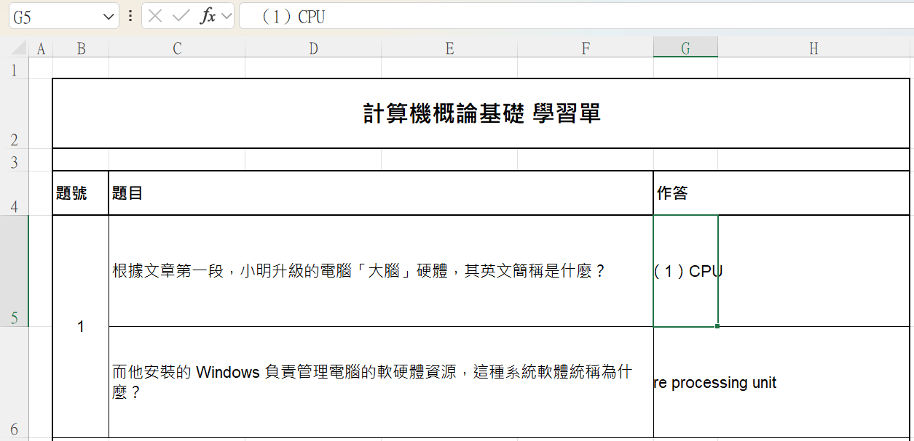
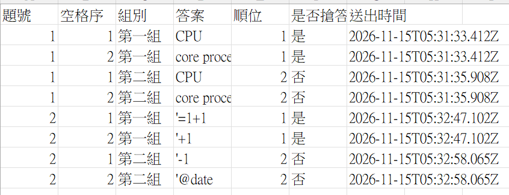

# 004 人工驗證紀錄（T031）

- 執行人：philip110531（設計與驗證負責人）
- 日期：2026-11-15
- 分支：`004-export`
- 環境：Windows＋Chrome；老師 T、學生 A1（第一組）、B（第二組）各用一個獨立分頁
- 依據：[`specs/004-export/quickstart.md`](../../specs/004-export/quickstart.md) 的 18 個步驟，加上 Google Sheets 匯回（SC-005）

## 總結（2026-11-17 複測後更新）

功能流程正確：權限、階段檢查、作廢排除、重複匯出、空活動匯出都符合預期。2026-11-15 首次驗證發現的 4 項問題處理如下，**複測通過，建議合併**：

| # | 問題 | 對應步驟 | 最終狀態 |
|---|---|---|---|
| A | 題組答案寫到了前綴格（「（1）」那格），原本放答案的格子反而空著 | 8 | **已修正並複測通過**：題組依原檔 merge range 寫入（02 前綴格保持原樣、答案寫右側獨立答案格；04 合併填答區保留「前綴＋答案」） |
| B | 檔名與 CSV「送出時間」都是 UTC，比台灣時間少 8 小時 | 7、10、11 | **已修正並複測通過**：檔名與 CSV 送出時間均為教室／伺服器本地時間；CSV 格式為 `YYYY-MM-DD HH:mm:ss.SSS`，無 `Z` 或時區後綴 |
| C | CSV 中以 `=`、`+`、`-`、`@` 開頭的答案，在 Excel 會顯示 `'` 符號 | 13 | **經兩組決議（2026-11-16）保留現狀**：FR-014 的前導 `'` 是公式注入防護的一部分，本次不變更；步驟 13 依決議記為通過 |
| D | （文件）步驟 1 的預期描述與畫面不符 | 1 | **已修正**：`quickstart.md` 步驟 1、2 預期文字已改 |

另有兩項建議（E、F），列在最後供討論。

## 2026-11-17 複測紀錄（A、B 對應步驟）

- 執行人：philip110531；以修正後版本複測 A、B 涉及的步驟 7、8、10、11，全數通過，並在 [PR #5](https://github.com/Danielweng0902/Answering-System_speckit/pull/5) 正式 Approve（「人工驗證沒問題」，2026-11-17）。
- 本文件「步驟結果」表已依複測結論更新；複測結論由執行人 commit `4224ee8` 與 PR Approve 記錄，本節為整理記錄，不自動測試或截圖替代人工驗證。
- 下方「首次驗證發現」各節（A–D）保留 2026-11-15 的原始觀察，僅作歷史紀錄。

## 步驟結果

| 步驟 | 結果 | 備註 |
|---|---|---|
| 1 | ⚠️ 文件問題 | 老師端有顯示題號 1–4，但**看不到**「（1）」「（2）」兩個輸入欄，見問題 D |
| 2 | 通過 | |
| 3 | 通過 | 搶答中老師頁面沒有匯出按鈕；直接呼叫 API 回 `409 INVALID_PHASE` |
| 4 | 通過 | |
| 5 | 通過 | |
| 6 | 通過 | |
| 7 | 通過（2026-11-17 複測） | 下載 `搶答結果_日期時間.xlsx`，檔名為本地時間；首次驗證的 8 小時偏差已修正（檔名建議另見 E） |
| 8 | 通過（2026-11-17 複測） | 題組前綴格保持原樣、答案寫入右側獨立答案格；單題、未作答題與格式保留皆正確（首次驗證問題 A 已修正） |
| 9 | 通過 | 匯出檔重新上傳可解析，題數與空格數與原檔相同 |
| 10 | 通過 | 下載 CSV，Excel 開啟中文不亂碼；檔名為本地時間（問題 B 已修正）；建議另見 E、F |
| 11 | 通過（2026-11-17 複測） | 欄位、每格一列、排序、「是／否」皆正確；「送出時間」為本地 `YYYY-MM-DD HH:mm:ss.SSS`（首次驗證問題 B 已修正） |
| 12 | 通過 | 含逗號、引號的答案仍在同一欄，沒有錯位 |
| 13 | 通過（依 2026-11-16 兩組決議） | CSV 中 `=1+1` 以文字顯示（沒有被算成 2）；前導 `'` 為 FR-014 公式防護，兩組決議保留不變更；xlsx 無 `'` 屬正常 |
| 14 | 通過 | 沒有人作答時，CSV 只有欄位名稱一列 |
| 15 | 通過 | 連續匯出兩次，內容相同 |
| 16 | 通過 | 學生身分呼叫 API 回 `403 FORBIDDEN` |
| 17 | 通過 | 被作廢且未重送的題目：xlsx 維持空白，CSV 沒有該組的列 |
| 18 | 通過 | 重設後呼叫 API 回 `409 INVALID_PHASE` |
| SC-005 | 通過 | 匯出的 xlsx 上傳到 Google 雲端硬碟，以試算表開啟並改為「知道連結者可檢視」，再用連結匯入，可正常解析 |

## 首次驗證發現（2026-11-15 歷史紀錄；A、B、D 已修正，C 經兩組決議保留）

### A. 題組答案寫到前綴格（步驟 8）

**現象**：題組題目的作答區原本分成左右兩格，左格是子題號「（1）」，右格空著讓學生寫答案。匯出後答案變成「（1）答案」，跟子題號擠在左格，右格反而是空的。

以 `02-official-group.xlsx` 為例：

| 位置 | 原檔 | 目前匯出 | 預期匯出 |
|---|---|---|---|
| G5 | （1） | （1）A | （1） |
| H5 | （空白） | （空白） | A |

**原因**：`research.md` R5 決定把「前綴＋答案」寫進同一格（`guidedNotesExporter.ts` 的 `buildBlankContent`），寫入位置是 002 解析時記錄的前綴格 `blank.cell`（例如 G5）。官方題組版面的前綴格和答案格是分開的兩格（G5／H5，沒有合併），所以答案位置跟紙本學習單不一致。

**建議**：前綴格右邊如果是獨立的空白答案格，答案就寫進答案格，前綴格保持原樣；單題的作答格是合併的 G:H，維持現在的寫法。這會動到 R5 的決策，以及 quickstart 步驟 8 的預期文字（目前寫的是「（1）答案」在同一格），需要一併修改。

### B. 時間少 8 小時（步驟 7、10、11）

**現象**：

- 檔名：`exportCommands.ts` 的 `buildExportFileName` 用 `getUTC*` 組時間，例如台灣時間 22:17 匯出，檔名是 `_1417`；早上 8 點前匯出，日期還會是前一天。
- CSV「送出時間」：直接輸出資料庫的 ISO 字串（例如 `2026-11-14T14:17:33.100Z`），老師看到的是 UTC 時間，不是上課當下的時間。

**建議**：檔名和「送出時間」都改用台灣時間（UTC+8）。「送出時間」建議改成老師容易看懂的格式，例如 `2026-11-14 22:17:33.100`；資料庫維持 UTC 不變。這會動到 `contracts/http-api.md` 對「送出時間」格式的描述，需要一併更新。

### C. CSV 顯示 `'` 符號（步驟 13）

**現象**：為了防止公式注入，以 `=`、`+`、`-`、`@` 開頭的答案在 CSV 裡前面會加 `'`（`csvBuilder.ts` 的 `safeFormulaGuard`）。Excel 開 CSV 時這個 `'` 會直接顯示出來，例如 `'=1+1`、`'-5`。同一份答案在 xlsx 裡顯示正常。

**建議**：保留公式防護，但改用不會被老師看到的做法，請實作者評估可行方式並補測試。數學答案像 `-5` 很常見，老師看到 `'-5` 容易誤會成學生打錯。

### D. 步驟 1 的預期描述與畫面不符（文件）

**現象**：步驟 1 的預期寫「老師端顯示題號 1–4；第 1、2 題有『（1）』『（2）』兩個輸入欄」。實際老師端只有題目清單，沒有輸入欄。

**推測**：輸入欄是學生端在「開啟搶答」之後才會出現的畫面（003 已驗證）。這比較像是 quickstart 的描述有誤，不是程式問題。建議把步驟 1 的預期改成「老師端顯示題號 1–4，第 1、2 題為題組」，輸入欄的檢查移到步驟 2 的學生端。如果原意確實是老師端也要看到，請告知。

## 建議（供討論）

### E. 匯出檔名（步驟 7、10）

1. **兩種檔案用不同名稱**：現在 xlsx 和 CSV 都叫「搶答結果_日期時間」，只能靠副檔名區分。建議 xlsx 維持「搶答結果」，CSV 改為「搶答紀錄」，一看就知道哪個是填好答案的學習單、哪個是完整作答紀錄。
2. **檔名時間要不要改用活動時間？**現在用的是「下載時間」。老師可能週一上課搶答、週三才匯出，這時檔名顯示的是週三，比較難對回是哪一堂課。是否考慮改用該次活動的開始或結束時間（例如 `opened_at` 或 `closed_at`）？同一次活動匯出幾次，檔名也會一致。這點牽涉 FR-007 的定義，想聽聽大家的看法。

### F. 作答紀錄的檢視格式（步驟 10）

用 Excel 開 CSV 時，長答案會蓋過右邊的格子，閱讀不方便。希望匯出時就設定好格式，例如欄寬配合文字長度、長答案自動換行。

需要注意的是，CSV 是純文字格式，只存資料，**沒辦法存任何格式**（欄寬、自動換行、粗體、凍結窗格都不行），Excel 開啟時一律套用預設樣式。所以只改 CSV 做不到，要改用 xlsx 才能帶格式。可以考慮的方向：

- **作答紀錄多提供一個 xlsx 版本**（CSV 保留給要匯入其他系統的情況）。在 xlsx 裡預先設定：
  - 欄寬依內容長度設定，「答案」欄給上限寬度並開啟自動換行；
  - 第一列欄位名稱粗體並凍結，往下捲動時仍看得到；
  - 「送出時間」設定為日期時間格式。

  xlsx 本身不會執行公式注入，問題 C 的 `'` 在這個版本也不會出現。
- 或直接把作答紀錄改成只匯出 xlsx。

CSV 格式是兩組共同約定的（FR-012、Feature Contract D13），新增或改變格式需要兩組同意。這點不擋本次合併，可以排到之後的版本。
