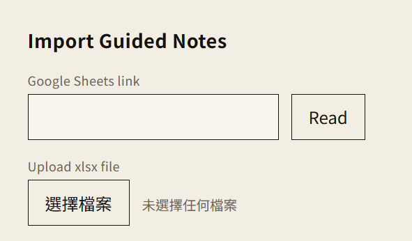

# 007 人工驗證紀錄

- 執行人：philip110531（設計與驗證負責人）
- 日期：2026-11-23
- 分支：`main`（`a882c1d`，PR #36 合併後）
- 環境：Windows＋Chrome 157.0.8103.79（正式版本，64 位元）；老師端以寬視窗開啟，學生端以 DevTools 裝置模式 390px 寬模擬手機；投影看板全螢幕
- 依據：[`007-manual-checklist.md`](./007-manual-checklist.md) 的 11 個檢查項目

## 步驟結果

| # | 檢查項目 | 預期 | 結果 | 備註 |
|---|---|---|---|---|
| ① | 預設語言跟著系統（AC-007-01／02） | Chrome 語言設英文 → 英文；重開仍英文；設回繁中 → 繁中 | 通過 | |
| ② | 切換與持久化（AC-007-01） | 按「中文／EN」立刻切換、不重新載入；F5 後維持 | 通過 | |
| ③ | 跨分頁同步 | A 分頁切英文，B 分頁跟著變英文 | 通過 | |
| ④ | 每個畫面都有切換鈕（AC-007-03） | 學生端、老師登入頁、老師登入後、投影看板、首頁右上角都有「中文／EN」 | 通過 | |
| ⑤ | 切換後整頁一致（AC-007-03） | 老師端切英文後，各區沒有殘留中文 | **不通過** | 「匯入學習單」區的檔案上傳按鈕在英文介面仍顯示「**選擇檔案**」「**未選擇任何檔案**」，見下方問題 1。其餘各區（頁首、搶答控制、題目清單、組別管理、投影區、作答看板）皆為英文 |
| ⑥ | 作答流程不受影響（AC-007-04） | 英文介面下可正常選組、作答、送出；切換語言後答案內容不變、不被翻譯 | 通過 | |
| ⑦ | 螢幕閱讀器標籤（AC-007-05） | 英文為「Question 1」，中文為「第 1 題」 | 通過 | 以 Console 執行 `[...document.querySelectorAll('.visually-hidden')].map(e => e.textContent)` 檢查題號的隱藏文字 |
| ⑧ | `<html lang>`（AC-007-06） | 中文 `"zh-TW"`、英文 `"en"`，重新整理後維持 | 通過 | |
| ⑨ | 英文版排版沒有破 | 老師端、學生端 390px、投影看板沒有截斷或溢出 | 通過 | |
| ⑩ | 錯誤訊息的英文（AC-007-07） | 英文介面的錯誤與警告為英文，切回中文為中文 | 通過 | |
| ⑪ | 不翻譯資料 | 匯入中文題目，英文介面下題目維持中文；學生答案維持原樣 | 通過 | |

## 結果與問題

11 項中 10 項通過，1 項不通過。

### 問題 1：檔案上傳按鈕在英文介面沒有翻譯

| 項目 | 內容 |
|---|---|
| 位置 | 老師端「Import Guided Notes」→「Upload xlsx file」 |
| 現象 | 標籤已是英文，但按鈕顯示「選擇檔案」，旁邊顯示「未選擇任何檔案」 |
| 原因 | 這兩句不是網頁的文字，是瀏覽器原生 `<input type="file">` 自己顯示的，**跟著 Chrome 的介面語言**，不跟網頁的語言切換，翻譯檔管不到。PR #39 只改了按鈕的外觀（`::file-selector-button`），文字仍由瀏覽器提供 |
| 影響 | 介面語言與瀏覽器語言不同時（例如中文版 Chrome 切成 EN），這一區會中英混雜 |
| 建議 | 把原生檔案元件用 `visually-hidden` 藏起來（保留鍵盤與螢幕閱讀器可用），改用 `<label htmlFor>` 做成自己的按鈕，文字和「未選擇檔案／檔名」都走 i18n。需注意：藏起來的 input 仍要能用 Tab 聚焦，焦點外框要顯示在自製按鈕上 |

依清單規定，本人未修改程式，交由組員評估。
